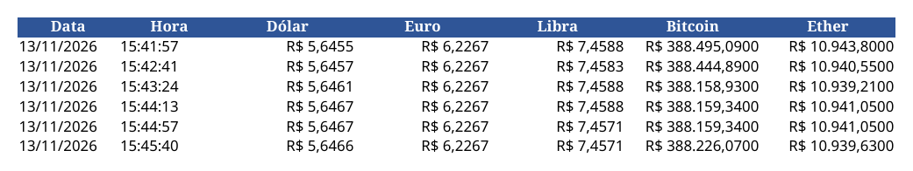
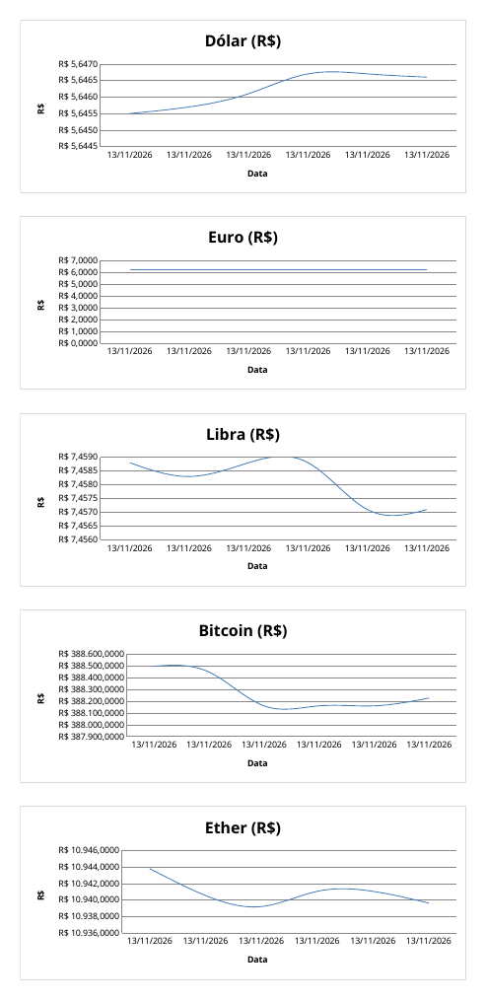

# Robô de Cotações (Python + RPA + Excel)

Robô que abre o navegador sozinho, lê a cotação de **dólar, euro, libra, bitcoin e ether** no Google Finanças, salva tudo numa planilha Excel com gráficos, avisa quando um preço passa do limite e manda o relatório por e-mail, todo dia, sem ninguém precisar fazer nada.

Planilha gerada pelo robô (aqui foram 6 execuções seguidas, uma por minuto, só pra teste):



Aba de gráficos, com um gráfico por moeda:



## Funcionalidades
- **Automação do navegador (RPA)**: abre o Chrome e lê os preços direto da página
- **Planilha Excel**: uma linha por execução, com data, hora e formato de moeda
- **Gráficos**: um gráfico de variação por moeda, atualizado a cada execução
- **Alertas**: avisa quando uma moeda sobe acima ou cai abaixo de um valor escolhido
- **E-mail**: manda a planilha em anexo, sempre ou só quando houver alerta
- **Agendamento**: roda sozinho todo dia no horário escolhido
- **Tolerante a falhas**: se uma moeda não carregar, o robô segue com as outras

## Tecnologias
Python 3 · Selenium · openpyxl · smtplib · systemd

## Como usar

### 1. Instalar
```bash
python -m venv .venv
source .venv/bin/activate      # no Windows: .venv\Scripts\activate
pip install -r requirements.txt
```
Você precisa ter o Google Chrome instalado.

### 2. Configurar (opcional: e-mail e alertas)
```bash
cp config.exemplo.ini config.ini
```
Abra o `config.ini` e preencha. Pro Gmail, use uma **senha de app**, e não a sua senha normal.

### 3. Rodar
```bash
python robo_cotacoes.py              # roda em segundo plano
python robo_cotacoes.py --ver        # abre o Chrome pra ver o robô trabalhando
python robo_cotacoes.py --sem-email  # roda sem mandar e-mail
```

### 4. Agendar pra rodar todo dia (Linux)
```bash
./agendar.sh          # todo dia às 9h
./agendar.sh 18 30    # todo dia às 18h30
./agendar.sh status   # mostra a próxima execução
./agendar.sh remover  # cancela
```
O que o robô imprime fica salvo em `robo.log`.

## Adicionar uma moeda
No `robo_cotacoes.py`, inclua uma linha no dicionário `MOEDAS`:
```python
"Iene": {"par": "JPY-BRL", "nome": "Iene japonês / Real brasileiro"},
```
O `nome` é o texto que aparece em cima do preço na página do Google Finanças. Na planilha, a coluna nova é criada sozinha.

## Estrutura
```
robo_cotacoes.py     # o robô
config.exemplo.ini   # modelo de configuração
agendar.sh           # agendamento diário
requirements.txt     # bibliotecas
```
